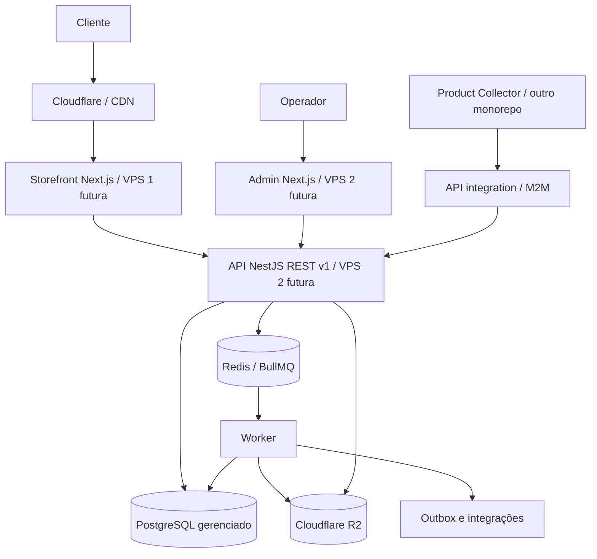

# ETAPA 0 — ARQUITETURA TÉCNICA V1

Base normativa: Contexto Mestre V1.0 de 10/10/2026. Este documento explicita decisões adicionais da implementação inicial; não afirma que serviços ou testes estejam operacionais.

## 1. Visão geral e limites

**Padrão:** monorepo TypeScript com quatro apps e um **monólito modular** no backend NestJS. Catálogo, pagamentos, clientes, pedidos e estoque pertencem ao backend; frontend acessa API, não PostgreSQL. O sistema aceita múltiplas lojas por store, mas não é um marketplace com carteiras/vendedores independentes.

*O diagrama representa a implantação futura, não o ambiente de execução atual.*

## 2. Apps e responsabilidades

| App | Responsabilidade | Execução local |
|---|---|---|
| `apps/storefront` | catálogo público, pesquisa, PDP, favoritos, carrinho, checkout, conta, SEO, acessibilidade | `localhost:3000` |
| `apps/admin` | operadores, painéis, CRUD comercial, importações, RBAC, auditoria, configurações | `localhost:3001` |
| `apps/api` | API REST pública/cliente/admin/integration, domínio, auth, transações, OpenAPI | `localhost:4000` |
| `apps/worker` | consumo BullMQ, mídia, importação, reconciliação, reenvio outbox e tarefas agendadas | sem porta pública |

Endereços opcionais: `store.localhost`, `admin.localhost`, `api.localhost`; usar fallback por portas se Windows/DNS local não resolver. Configuração via `.env` ignorado pelo Git. Em produção, não expor admin e worker pelo mesmo ingresso público indiscriminadamente; acesso ao admin sujeito a autenticação forte e camada de proteção adicional.

## 3. Pacotes e direção de dependências

| Pacote | Escopo |
|---|---|
| `database` | Prisma schema, migrations, Prisma Client, repositórios e limites transacionais |
| `contracts` | DTOs/contratos públicos REST e eventos internos, versionados |
| `validation` | validações Zod comuns, normalizadores puros, sem HTTP |
| `auth` | políticas de autenticação, RBAC, scopes e sessão; sem dependência de Next |
| `catalog` | regras puras de produtos, variantes, categorias e atributos |
| `commerce` | carrinho, preço efetivo, estoque, pedidos, frete, política de promoções |
| `payments` | interfaces de gateway, eventos padronizados, reconciliação |
| `media` | contrato de S3/R2, deduplicação e validação de mídia |
| `ui` | componentes visuais reutilizáveis, sem regras de domínio ou segredos |
| `config` | esquemas de ambiente tipados, constantes, feature flags |
| `observability` | logs estruturados, traceId/requestId, métricas, redaction |

**Regra:** `apps/*` pode importar `packages/*`; `packages/*` não importa `apps/*`. Domínio puro não importa Next ou Nest. `database` e implementações infra não entram no bundle do navegador. Restringir imports com regras de lint/dependency-cruiser quando o monorepo estiver funcional. Dependências circulares reprovam CI.

## 4. Domínios da API

- `HealthModule`: health, readiness (DB/Redis conforme fase).
- `StoresModule`: stores/domínios/configurações, validação de contexto tenant.
- `AdminIdentityModule`: operadores, sessões, MFA e RBAC.
- `CustomerIdentityModule`: clientes, autenticação, endereços e dados pessoais.
- `BrandsModule`, `CategoriesModule`, `AttributesModule`, `ProductsModule`, `VariantsModule`.
- `MediaModule`: registros, uploads assinados, ingestão segura e associação a produtos.
- `InventoryModule`: saldo disponível, reserva, movimentação e localização.
- `PricingModule`, `PromotionsModule`, `CouponsModule`.
- `SearchModule`: pesquisa/filtros de catálogo, primeira versão apoiada por índices PostgreSQL e consulta paginada.
- `CartModule`, `CheckoutModule`, `OrdersModule`, `ShippingModule`.
- `PaymentsModule`, `WebhooksModule`, `RefundsModule`, `ReconciliationModule`.
- `IntegrationsCatalogModule`: recebimento JSON M2M, lotes, itens, reprocessamento, feedback ao coletor.
- `StorefrontContentModule`: banners, seções, slots e SEO.
- `CustomersModule`, `MarketingConsentModule`.
- `AuditModule`, `OutboxModule`, `IdempotencyModule`, `JobsModule`.

Cada módulo define controllers/routes, application services, domain logic, persistência (repository port/adapters), schemas e testes. Evitar dependência circular entre módulos (publicação de eventos/outbox e interfaces explícitas quando necessário).

## 5. Fluxos transacionais críticos

### Pedido

1. Carrinho envia intenção, sem preço confiado ao cliente.
2. API resolve loja e produtos, preço ativo, promoções, estoque, frete, cupom e restrições.
3. API executa transação: cria pedido e snapshots das linhas, reserva estoque de forma concorrente e grava evento outbox.
4. Provedor recebe tentativa idempotente de pagamento fora da transação DB longa.
5. Webhook verificado e evento deduplicado atualizam pagamento e pedido; criação de efeitos via outbox.
6. Worker reconcilia estados desconhecidos, expiração de reservas e estornos.

O pedido e seu histórico não dependem da permanência dos dados em Redis. Operação de reservas deve usar bloqueio/atualização atômica e constraints no PostgreSQL para evitar oversell. Definir timeout e retentativas para deadlocks. Não manter transação PostgreSQL aberta durante chamada HTTP a gateways.

### Publicação/catálogo

Admin ou importador grava alterações com histórico e outbox. Consumidores invalidam cache do storefront por tags/chaves por loja. Falhas de invalidação têm retentativa e TTL de segurança. Somente produtos `PUBLISHED`, vinculados à loja, aparecem publicamente.

### Importação

API autentica o coletor e sua loja; grava lote com idempotência; responde `202 Accepted`; worker valida/upserta por identidade externa; mídia é obtida por serviço servidor seguro e armazenada no R2; relatório final por item e reconciliação do catálogo.

## 6. Segurança e isolamento

- Resolver `storeId` a partir de domínio, rota e credencial, e conferir coerência em toda mutação. NUNCA aceitar `storeId` do cliente como única prova de acesso.
- Enforce tenant no nível de consulta, índices e FKs compostas `storeId` onde apropriado; testes de isolamento negativo obrigatórios. Considerar RLS posteriormente como defesa adicional, sem substituir filtros de aplicação.
- Sessões via cookie `Secure`, `HttpOnly`, `SameSite` apropriado; CSRF para mutações cookie-auth; CORS específico, sem `*` com credenciais.
- Login admin com MFA e RBAC por loja, rate limiting e registro de auditoria. Segredos de gateway e de coletor armazenados cifrados/referenciados, nunca expostos ao browser ou logs.
- Armazenar hash de senhas com algoritmo robusto e política de recuperação/rotação; limitar tentativas de autenticação.
- Validar inputs via Zod nos limites, sanitizar renderização, CSP, URLs e uploads. Webhooks exigem assinatura, timestamp/janela quando provedor permitir, body bruto e proteção contra replay.
- Importação de URLs externas: allowlist configurável, protocolos HTTPS, resolução DNS defensiva, rejeitar IP privado/link-local/metadata, validar a cada redirect, timeouts, limites de bytes, MIME real e formatos; execução fora da rede privilegiada quando possível.
- Audit logs com ator, loja, ação, recurso, diff seguro, requestId e data; nunca guardar CPF, tokens ou senhas em claro nos logs.

## 7. Cache, filas e observabilidade

- Redis serve cache transitório, rate limit e BullMQ; jamais ledger de pedidos/pagamentos.
- Outbox no PostgreSQL com processador idempotente, retry exponencial, dead-letter/reprocessamento e sinalização de atraso.
- Chaves de cache e jobs contêm `storeId`; não reutilizar identificadores entre lojas.
- Tracing por `requestId`, `correlationId`, `importBatchId` e `orderId`; logs JSON redigidos; health check sem segredos.
- Índices e paginação por cursor onde volume exigir; usar busca PostgreSQL inicialmente, planejar busca dedicada apenas após benchmarks.

## 8. Ambientes

| Aspecto | Local (obrigatório) | Produção futura (somente após homologar) |
|---|---|---|
| Storefront | localhost:3000 | VPS 1 Contabo |
| Admin + API + Worker | localhost:3001, localhost:4000, worker | VPS 2 Contabo isolada em containers |
| Redis | Docker local | VPS 2 |
| PostgreSQL | Docker local ou Railway Dev segregado | provedor gerenciado externo |
| Mídia | adaptador fake/local para testes + bucket R2 dev opcional | R2 |
| Pagamentos | mock + sandbox | gateway real configurado por loja |

Railway pode ter cobrança conforme plano/uso; não considerar gratuidade garantida. Não usar dados pessoais reais em testes. Proteção de migrations: comandos destrutivos proibidos por padrão em URLs remotas, ambiente DEV explícito e credenciais de banco separadas para migrate/runtime.

## 9. Escala e desempenho

Meta ilustrativa inicial do contexto: 10 a 50 mil produtos; ensaiar centenas de milhares de SKUs. Não prometer SLA sem testes. Medir: latência P95 catálogo, throughput de importação, número de workers, uso de CPU/memória, velocidade de invalidar cache, e transações sob concorrência. Reavaliar índices, particionamento e mecanismos de pesquisa somente com dados.

## 10. Política de backup e recuperação

Desde o ambiente local, ter migrações versionadas, exportação lógica e restore testado com dados sintéticos. Para produção: PITR do provedor contratado quando oferecido, backup lógico criptografado fora do banco, retenção e verificação de restauração, cópias de mídia em domínio de falha distinto, reconstrução de VPS a partir do Git/deploy reproduzível. Definir RPO/RTO e periodicidade na Etapa 15 com testes; não declarar backup validado sem restore.

## 11. Riscos e mitigação

| Risco | Mitigação de projeto |
|---|---|
| Vazamento cruzado entre lojas | storeId em FKs, políticas e testes de cross-tenant |
| Estoque vendido duas vezes | reserva atômica em transação e testes concorrentes |
| Eventos e webhooks duplicados | idempotency key, unique constraints, outbox, reconciliação |
| SSRF via mídias externas | fetch worker isolado, allowlist + bloqueio IP/DNS + tamanhos |
| Importação confundir variantes | identidade externa por fonte e agrupamento explícito, sem heurística agressiva |
| Falha Railway/quota | Docker Postgres local, configs segregadas, backups de teste |
| Custos de R2 e filas | limites configuráveis, lifecycle policy, jobs em lotes, observabilidade |
| Desvios no design de referência | usar Figma para estudo, materiais próprios na publicação comercial |
| Incompatibilidade de versões | `packageManager` fixo, lockfile, setup matrix, CI e sem `latest` no projeto |

## 12. Próximas entregas

A Etapa 1 funda apps e pacotes sem banco real. Etapa 2 torna Redis/PostgreSQL locais operacionais. Etapa 3 implementa entidades/migrations. Etapas 4–17 seguem **exatamente** a ordem do Contexto Mestre V1. A experimentação isolada do Hero pode ocorrer após a fundação funcional, sem desviar o roadmap.
