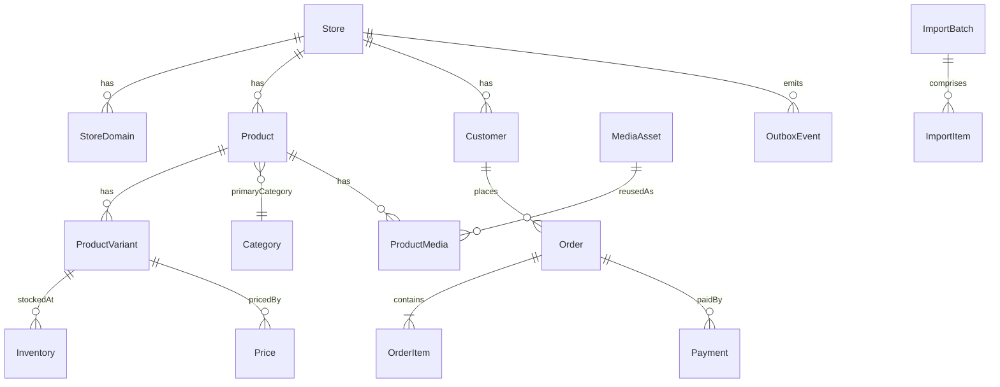

# MODELO DE DADOS V1 — Planejamento (não é schema Prisma executável)

**Status:** aprovado para iniciar modelagem na Etapa 3; detalhes de colunas podem ser refinados com migration/ADR. Fonte normativa: Contexto Mestre V1, seções 6–17.

## Regras globais

- PK: UUID; `createdAt`, `updatedAt` em UTC; `deletedAt` somente quando apropriado e não para ledger financeiro.
- Todas as entidades comerciais pertencem a uma loja `storeId`, salvo registros globais explicitamente assinalados. A aplicação **valida storeId em todo acesso**.
- Identificadores externos são exclusivos por `(storeId, sourceId, externalId)`; SKUs por `(storeId, sku)` quando a loja exigir SKU único. `slug` único `(storeId, slug)` por escopo da entidade.
- Dinheiro no PostgreSQL como `BIGINT` em centavos; em REST como inteiro seguro em centavos, limite de negócio inferior ao máximo inteiro exato do JSON; conversão explícita no backend, sem float. `currency='BRL'` por padrão.
- Descontos percentuais armazenados como `DECIMAL(7,4)` (0 a 100,0000); cálculo decimal e arredondamento determinístico para centavos, sem aritmética de ponto flutuante.
- Snapshots de nome/SKU/preço/descontos/impostos/frete/currency nos itens do pedido; mudanças de catálogo nunca reescrevem pedidos históricos.
- Constraints de consistência: `price >= 0`, `quantity >= 0`, `reserved >= 0`, unicidades compostas por loja, FKs tenant-aware sempre que viável. Índices parciais de status/publicação quando medidos.
- PII minimizada e política de retenção/anonimização; logs/auditoria não são depósito de dados sensíveis.

## 1. Multi-loja e identidade

| Entidade | Campos relevantes | Relações/restrições |
|---|---|---|
| `Store` | id, slug, displayName, status, currency, timezone, settings | 1:N com quase todas entidades |
| `StoreDomain` | id, storeId, hostname, verifiedAt, isPrimary, status | hostname globalmente único, verificação de domínio |
| `AdminUser` | id, emailNormalizado, passwordHash, status, mfaState | autenticação admin global |
| `AdminMembership` | id, storeId, adminUserId, roleId, status | chave única storeId+adminUserId+roleId |
| `Role` | id, storeId?, name, immutable | escopo global/sua loja |
| `RolePermission` | roleId, permissionCode | RBAC, não permissões confiadas ao frontend |
| `AdminSession` | id, adminUserId, tokenHash, expiresAt, revokedAt, mfaVerifiedAt | sessões auditáveis/rotativas |
| `Customer` | id, storeId, emailNormalizado, name, status | UNIQUE(storeId,emailNormalizado) |
| `CustomerCredential` | customerId, passwordHash, verifiedAt, reset state | não armazenar senha em claro |
| `CustomerSession` | id, storeId, customerId, tokenHash, expiresAt | escopo loja |
| `Address` | id, storeId, customerId, recipient, postalCode, fields | pertencimento tenant e usuário |

## 2. Catálogo e mídia

| Entidade | Campos relevantes | Relações/restrições |
|---|---|---|
| `Brand` | storeId, slug, name, status | store 1:N brands |
| `Category` | storeId, parentId?, slug, name, path, position, status | árvore; impedir ciclos |
| `CategoryAttribute` | categoryId, definitionId, required, filterable, sortOrder | restrições por categoria |
| `AttributeDefinition` | storeId, code, name, dataType, unit, optionsJson | definições versionáveis |
| `Product` | storeId, brandId?, categoryId, slug, title, description, seo, publicationStatus, sourceMode | store 1:N products |
| `ProductCategory` | storeId, productId, categoryId | suporte a mais de uma categoria, primary em Product |
| `ProductVariant` | storeId, productId, sku, externalKey?, ean?, variantAttributes, physical dimensions, status | UNIQUE(storeId,sku) quando sku não nulo |
| `ProductAttributeValue` | storeId, productId, definitionId, typedValue | atributos comuns |
| `VariantAttributeValue` | storeId, variantId, definitionId, typedValue | cor, tamanho, voltagem, capacidade etc. |
| `MediaAsset` | storeId, storageKey, sha256, mimeType, bytes, width, height, duration, processingStatus | uma mídia pode ter N associações; dedupe por hash + política de loja |
| `MediaRendition` | mediaAssetId, format, width, height, storageKey | variantes otimizadas |
| `ProductMedia` | storeId, productId, mediaAssetId, role, sortOrder | reuse do mesmo arquivo |
| `VariantMedia` | storeId, variantId, mediaAssetId, role, sortOrder | fotos específicas sem duplicação |
| `ExternalIdentity` | storeId, sourceId, productId?, variantId?, externalId, groupId? | identidade importada imutável por origem |

**Regra de agrupamento:** `groupExternalId` indica intenção de agrupamento para uma origem; não juntar modelos distintos apenas por títulos similares. Identidades externas podem apontar para produto/variante já cadastrados mediante vínculo explícito e auditado.

## 3. Estoque, preços e promoções

| Entidade | Campos relevantes | Relações/restrições |
|---|---|---|
| `InventoryLocation` | storeId, code, name, active | depósitos futuros sem redesenho |
| `Inventory` | storeId, variantId, locationId, onHand, reserved, version | UNIQUE(storeId,variantId,locationId), `reserved <= onHand` conforme política |
| `InventoryReservation` | storeId, orderId?, cartId?, variantId, quantity, expiresAt, status | cancelamento/expiração idempotente |
| `InventoryMovement` | storeId, variantId, locationId, delta, reason, actorRef, deduplicationKey | ledger imutável e auditável |
| `Price` | storeId, variantId, currency, amountCents, compareAtCents?, validFrom?, validTo? | preço aplicável determinado no servidor |
| `PriceHistory` | storeId, variantId, previousCents, newCents, changedBy, reason, changedAt | histórico, sem sobrescrita |
| `Promotion` | storeId, name, status, startsAt, endsAt, percentageDecimal, priority | 0..100, janelas de vigência |
| `PromotionTarget` | storeId, promotionId, targetType, targetId? | STORE/CATEGORY/PRODUCT/VARIANT |
| `Coupon` | storeId, code, rulesJson, maxUses, startsAt, endsAt | UNIQUE(storeId, code) |
| `CouponRedemption` | storeId, couponId, orderId, customerId?, redeemedAt | controlar limite concorrente |

**Descontos V1:** regra única não cumulativa entre promoções: promoção aplicável de maior `priority`, depois maior especificidade (variant > product > category > store), depois `id` estável para desempate. Cupom é **um mecanismo separado** cuja combinabilidade é explicitamente declarada pela campanha; configuração inicial conservadora: não combinável. Os cálculos seguem unidades inteiras/decimal e arredondamento por linha documentado em teste. Registro de promoção aplicada no pedido.

## 4. Carrinho, frete, pedidos e pagamentos

| Entidade | Campos relevantes | Relações/restrições |
|---|---|---|
| `Cart` | storeId, customerId?, anonymousKeyHash?, currency, status, expiresAt | carrinho persistente |
| `CartItem` | storeId, cartId, variantId, quantity | UNIQUE(storeId,cartId,variantId) |
| `ShippingQuote` | storeId, cartId?, destinationPostalCode, carrier, service, amountCents, expiresAt | cotação limitada no tempo |
| `CheckoutSession` | storeId, cartId, customerId?, status, idempotencyKey, expiresAt | não confiável como preço final |
| `Order` | storeId, number, customerId?, status, amount breakdown, currency, addressSnapshotJson, placedAt | UNIQUE(storeId, number), snapshot imutável |
| `OrderItem` | storeId, orderId, variantId?, skuSnapshot, titleSnapshot, quantity, unitPriceCents, discountCents, totalCents | deve sobreviver à remoção do produto |
| `OrderStatusHistory` | storeId, orderId, from, to, actor, reason, changedAt | trilha de alterações |
| `Shipment` | storeId, orderId, carrier, service, shippingAmountCents, tracking, status | um pedido pode ter N envios |
| `Payment` | storeId, orderId, providerCode, providerAccountRef, status, authorizedCents, capturedCents, externalPaymentId? | operação idempotente |
| `PaymentAttempt` | storeId, paymentId, requestKey, attempt, status, providerResponseSafe | UNIQUE(storeId,requestKey) |
| `PaymentWebhookEvent` | storeId, providerCode, providerEventId, signatureState, payloadHash, receivedAt, processedAt | UNIQUE(providerCode,providerEventId) quando global |
| `Refund` | storeId, paymentId, amountCents, reason, externalRefundId, status | não exceder saldo capturado elegível |

**Concorrência:** transações PostgreSQL e updates condicionais por quantidade/versão; tratar conflitos e idempotência. Expiração de reservas e retry são responsabilidade do worker, mas o estado autoritativo fica no banco. Reconciliar pagamentos pendentes com o provedor.

## 5. Integração, auditoria, marketing e outbox

| Entidade | Campos relevantes | Relações/restrições |
|---|---|---|
| `IntegrationClient` | storeId, clientId, secretHash/keyRef, scopes, status, rotatedAt | M2M restrita por loja |
| `ImportSource` | storeId, code, name, allowedDomains, provenancePolicy | origem autorizada |
| `ImportBatch` | storeId, sourceId, externalBatchId, payloadHash, status, total, processed, failed, submittedAt | UNIQUE(storeId,sourceId,externalBatchId) |
| `ImportItem` | storeId, batchId, externalProductId, status, attempts, errorCode, errorDetailsSafe | índice por batch/status |
| `ImportFieldOverride` | storeId, productId/variantId, fieldPath, policy, editedAt | política explícita manual > importado |
| `OutboxEvent` | storeId?, aggregateType, aggregateId, eventType, eventVersion, payloadJson, status, attempts, availableAt, createdAt | publish-after-commit seguro |
| `InboxEvent` | consumerName, eventId, processedAt | UNIQUE consumer+event para dedupe |
| `IdempotencyRecord` | storeId, scope, requestKey, requestHash, responseCode, responseSnapshot, expiresAt | mesmo key+body retorna mesma operação; body diferente é conflito |
| `AuditLog` | storeId?, actorType, actorId, action, objectType, objectId, diffRedactedJson, requestId, createdAt | append-only |
| `ConsentRecord` | storeId, customerId, purpose, channel, granted, source, version, recordedAt | LGPD / trilha de opt-in/out |
| `StorefrontBanner` | storeId, placement, mediaId?, linkTarget, position, start/end, status | configuração sem editar código |
| `StorefrontSection` | storeId, type, title, configJson, position, status | vitrine dinâmica |

## 6. Relacionamentos principais

## 7. Índices/estratégia de migrações

- Query principais: `(storeId,publicationStatus,createdAt,id)` para product; `(storeId,slug)` único; `(storeId,categoryId,id)`; `(storeId,sku)` único; `(storeId,status,placedAt,id)` para pedidos; `(storeId,sourceId,externalBatchId)` para import; `(status,availableAt,id)` para outbox.
- Busca: full-text/search normalizada e índices adequados para título/marca/SKU. Trigram/facetas avançadas só mediante perfil de consulta e benchmarks.
- Migration pequena, reversão planejada, nunca `migrate reset` em Railway. `prisma migrate dev` somente em Docker dev explicitamente identificado; em banco remoto dev usar fluxo de migrations revisado e `migrate deploy` apropriado.
- Incluir testes de constraints e multi-loja; gerar dados sintéticos significativos para volume.

## 8. Coisas ainda não implementadas

Este documento define entidades e regras, **não** cria `schema.prisma`, índices reais, migrations, triggers ou dados. Esses artefatos pertencem às Etapas 2 e 3 e exigem validação local antes de qualquer conclusão.
